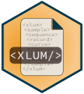

# Read, write, and convert XLUM data 

Support for the XLUM file format for exchange and long-term preservation
of luminescence data. The package facilitates the import and export of
XLUM files and the conversion from other ASCII and binary formats
commonly used to store luminescence (dating) data.

## Details

**Support contact**

- <https://github.com/R-Lum/xlum/discussions>

**Bug reporting**

- <https://github.com/R-Lum/xlum/issues>

**Project source code repository**

- <https://github.com/R-Lum/xlum>

**Package maintainer**

Sebastian Kreutzer, F2.1 Geophysical Parametrisation/Regionalisation,
LIAG - Institute for Applied Geophysics (Germany)  

**Funding**

- The initial [development of
  xlum](https://github.com/R-Lum/xlum_specification) received funding
  from the European Union's Horizon 2020 research and innovation
  programme under the Marie Skłodowska-Curie grant agreement No 844457
  (project: [CREDit](https://cordis.europa.eu/project/id/844457))

- Since 03/2023: Sebastian Kreutzer as maintainer of the package
  receives funding from the DFG Heisenberg programme [No
  505822867](https://gepris.dfg.de/project/505822867)

- The contribution by Marco Colombo was enabled through the DFG
  programme "REPLAY: REProducible Luminescence Data AnalYses" [No
  528704761](https://gepris.dfg.de/project/528704761)

## References

Kreutzer, S., Grehl, S., Höhne, M., Simmank, O., Dornich, K., Adamiec,
G., Burow, C., Roberts, H. M., Duller, G. A. T., 2023. XLUM: an open
data format for exchange and long-term preservation of luminescence
data. Geochronology, 5, 271-284,
[doi:10.5194/gchron-5-271-2023](https://doi.org/10.5194/gchron-5-271-2023)

## See also

Useful links:

- <https://r-lum.github.io/xlum/>

- Report bugs at <https://github.com/R-Lum/xlum/issues>

## Author

**Maintainer**: Sebastian Kreutzer
<maintainer_luminescence@r-luminescence.org>
([ORCID](https://orcid.org/0000-0002-0734-2199))

Authors:

- Sebastian Kreutzer <maintainer_luminescence@r-luminescence.org>
  ([ORCID](https://orcid.org/0000-0002-0734-2199))

- Marco Colombo ([ORCID](https://orcid.org/0000-0001-6672-0623))

Other contributors:

- Christoph Burow ([ORCID](https://orcid.org/0000-0002-5023-4046))
  \[contributor\]
